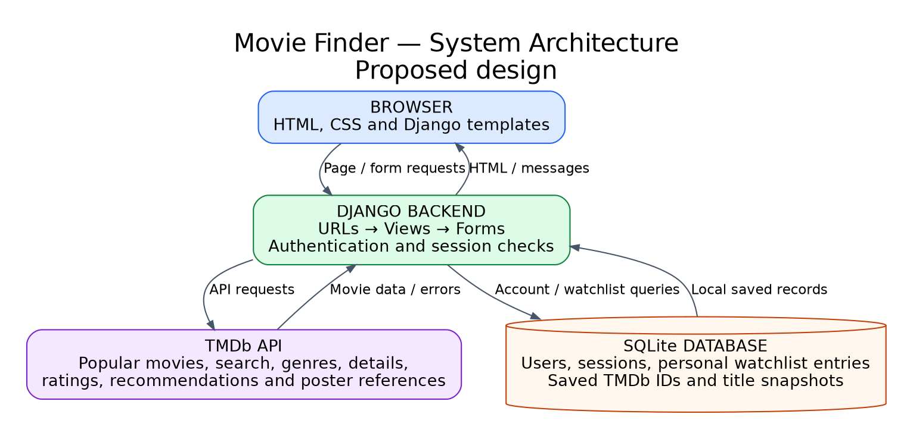
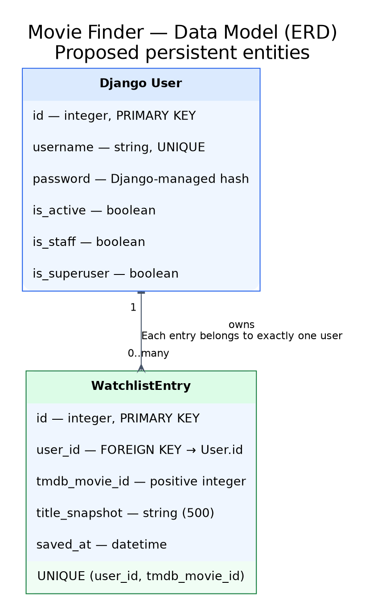
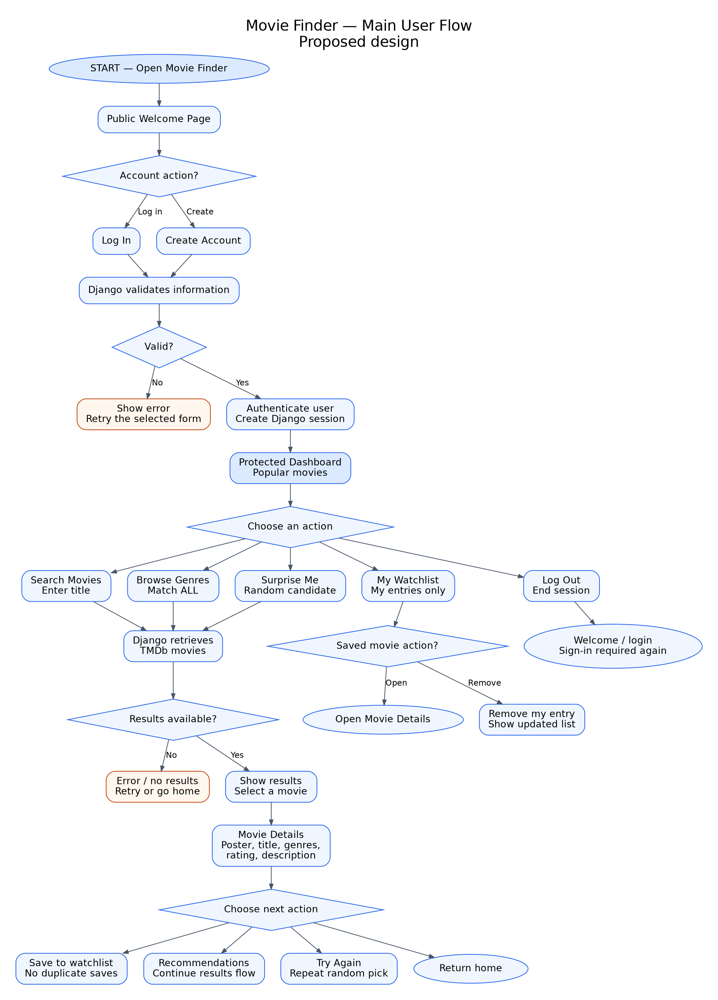

# System Design

## 1. Design baseline

- **Project:** Movie Finder — Kate McKenzie
- **Proposal:** [01-proposal.md](01-proposal.md), revised November 11, 2026
- **Status:** Planning draft. No application feature, test, screenshot or API connection is claimed complete.
- **Review:** No instructor feedback has been supplied. Student review and API verification remain open.

Movie Finder helps users choose something to watch through title search, genre browsing, TMDb recommendations and Surprise Me. Users create an account or log in, explore movies, and keep a private watchlist.

**Scope changes for the November 11 submission:** TMDb replaces the original CSV and local movie filtering. SQLite now stores accounts, sessions and saved movie references. Genre browsing matches ALL selected genres; rating, runtime and year filters are removed. Registration, popular movies, separate detail pages, posters and private watchlists are required. Trailers, streaming availability, personal ratings, watched status and custom/personalized recommendations are excluded.

Existing IDs retain their meanings from the revised proposal. FR-02 is retired and replaced by FR-16 for multi-genre browsing. FR-05 remains retired; FR-13–FR-15 are retired with the removed enhancements. FR-06 (watchlist) and FR-12 (posters) are now Must; FR-17 defines the public welcome page. FR-07 remains Later for TV shows and interface polish. No retired requirement or acceptance-criterion ID is reused. Open issues are collected in section 11.

## 2. System context

### Movie Finder — System Architecture

[Full-size SVG](diagrams/system-architecture.svg) · [Editable source](diagrams/system-architecture.dot)

The browser displays Django templates, HTML and CSS. Django checks login, validates forms, requests movie information from TMDb and returns pages. TMDb supplies popular movies, search results, genres, ratings, details, recommendations and poster references. SQLite stores users, sessions and private watchlist entries. It is not a local movie catalog. During an API outage, saved titles remain readable, but discovery and current details may be unavailable.

## 3. Data model

### Movie Finder — Data Model (ERD)

[Full-size SVG](diagrams/data-model.svg) · [Editable source](diagrams/data-model.dot)

Use Django's built-in User model and one WatchlistEntry model. A user owns zero or more entries; every entry belongs to one user. TMDb movie IDs identify external movies, so a local Movie table is not required. Standard session tables are omitted from the diagram for readability.

| Entity | Field | Django field type | Required / Default | Validation | Relationship / Deletion rule |
|---|---|---|---|---|---|
| User | id | Built-in primary key | Automatic | Unique | One user owns many saved entries |
| User | username | Built-in CharField | Required | Unique; Django username rules | Account identity |
| User | password | Built-in CharField | Required for password login | Django stores a hash and validates passwords | Never store plain-text passwords |
| User | is_active, is_staff, is_superuser | Built-in BooleanFields | Django defaults | Built-in account/admin checks | Admin permissions are separate from ordinary access |
| WatchlistEntry | id | BigAutoField | Automatic | Unique | Saved-entry identifier |
| WatchlistEntry | user | ForeignKey to AUTH_USER_MODEL | Required | Set from the signed-in user | CASCADE: deleting a user removes their entries |
| WatchlistEntry | tmdb_movie_id | PositiveIntegerField | Required | Valid movie ID; unique with user | External reference, not a local movie foreign key |
| WatchlistEntry | title_snapshot | CharField(500) | Required | Nonblank; validate length | Keeps saved titles readable during outages |
| WatchlistEntry | saved_at | DateTimeField(auto_now_add=True) | Automatic | Server timestamp | Removed with the entry |

A unique `(user, tmdb_movie_id)` pair prevents duplicate saves. Removing an entry does not delete the account, TMDb movie or another user's entry. Ownership rules are in section 6.

## 4. Pages and actions

These are proposed application URLs. Welcome, registration and login are public; all other routes require login. GET displays information; POST submits account changes or watchlist changes.

| Requirement ID | Page / URL | User action / HTTP method | Input and validation | Result / Template |
|---|---|---|---|---|
| FR-17 | Welcome `/` | GET | None | `welcome.html`: introduction and account links |
| FR-08, FR-04 | Register `/accounts/register/` | GET form; POST account | Unique username; matching valid passwords | `registration/register.html`: errors, or automatic login and redirect to dashboard |
| FR-01, FR-04, FR-09 | Login `/accounts/login/` | GET form; POST login | Django checks credentials | `registration/login.html`: error or dashboard redirect |
| FR-01 | Logout `/accounts/logout/` | POST only | Session and CSRF token | End session; redirect to welcome |
| FR-09, FR-12, FR-04 | Dashboard `/dashboard/` | GET | Request popular movies | `dashboard.html`: popular cards, search, genre browsing, Surprise Me and watchlist links |
| FR-10, FR-12, FR-04 | Search `/movies/search/?q=...` | GET | Trim title; require nonblank submitted text, maximum 200 characters | `movies/search.html`: form, selectable matches or helpful message |
| FR-16, FR-12, FR-04 | Browse `/movies/browse/?genre=...&genre=...` | GET | Show choices initially; require valid selected genre IDs on submission; match ALL | `movies/browse.html`: matching cards or validation/empty/error message |
| FR-11, FR-03, FR-12, FR-04 | Surprise Me `/movies/surprise/` | GET; Try Again repeats request | Valid bounded candidate set | Redirect to selected movie details with Try Again control; otherwise `movies/surprise.html` message |
| FR-03, FR-12, FR-04 | Details `/movies/<tmdb_id>/` | GET | Positive TMDb ID; handle missing movie/fields | `movies/detail.html`: required information, Save and recommendations controls |
| FR-10, FR-12, FR-04 | Related movies `/movies/<tmdb_id>/recommendations/` | GET | Valid selected ID; exclude original/duplicate IDs | `movies/recommendations.html`: related cards or message |
| FR-06, FR-01 | Watchlist `/watchlist/` | GET | Query only the signed-in user's entries | `watchlist/list.html`: saved titles, detail/remove controls or empty state |
| FR-06, FR-04 | Save `/watchlist/add/` | POST only | CSRF; validate TMDb ID/title server-side; session determines owner; prevent duplicates | Redirect to watchlist with saved/already-saved/error feedback |
| FR-06, FR-01 | Remove `/watchlist/<entry_id>/remove/` | POST only | CSRF; find entry by ID AND current user | Remove only that entry; redirect to list; unauthorized/missing entry gets generic not-found response |

Forms have visible labels and readable errors. Templates escape text. Shared cards use titles and posters/placeholders; details show the full required fields. Protected pages provide dashboard navigation and a logout form. Initial unsubmitted search/browse forms do not show an error. No numeric or year filters are included.

## 5. Main user flow

### Movie Finder — Main User Flow

[Full-size SVG](diagrams/main-user-flow.svg) · [Editable source](diagrams/main-user-flow.dot)

Valid login or registration creates a session and opens the dashboard. Users choose title search, genre browsing, Surprise Me or My Watchlist. Results lead to details, saving and related movies. Invalid input, empty results and API failures receive helpful messages. Rounded continuation nodes indicate retry, return-home or repeated discovery actions without long crossing arrows. Logout ends access to protected pages.

## 6. Access and login

| Role | Allowed actions | Ownership / Access restriction |
|---|---|---|
| Visitor | Welcome, registration and login | Cannot access discovery, details or watchlist, including by direct URL |
| Signed-in user | Dashboard, movie features and personal watchlist | Can view, save or remove only their own saved entries |
| Active superuser | Django Admin management of users and registered WatchlistEntry models | Separate admin permissions; ordinary application views still show only that signed-in user's entries |

Use Django's built-in user forms, password validation and session authentication. Successful registration automatically authenticates the user and redirects to `/dashboard/`; valid login does the same. Invalid submissions show errors without granting access. Django stores password hashes and manages the session, rather than custom password handling.

Enforce login in every protected view with `login_required` or its class-based equivalent. Set a saved entry's owner from `request.user`, never a submitted user ID. Filter list/removal queries by that user; changing an entry ID must not expose or remove someone else's data. Registration grants no admin permissions.

Registration, login, logout, saving and removal use CSRF-protected POST forms. GET must not change saved entries or log users out. After logout, a new protected-page request requires sign-in again. Account pages remain usable without TMDb.

Create a foundation demonstration account locally with Django's interactive `createsuperuser` command, then ordinary fictional accounts for registration and ownership checks. Keep passwords, tokens, session cookies and the local database out of Git and screenshots. Admin login alone does not satisfy the initial build: it needs a user-facing login and protected application page.

## 7. Integrations and configuration

| Dependency / API | Purpose | Official documentation | Environment variable names | Failure / Sample-data fallback |
|---|---|---|---|---|
| Python / Django | Backend, forms, authentication, templates and database access | [Python](https://docs.python.org/3/), [Django](https://docs.djangoproject.com/en/stable/) | `DJANGO_SECRET_KEY`; optional local settings `DJANGO_DEBUG`, `DJANGO_ALLOWED_HOSTS` | Select compatible versions and pin them during implementation. Authentication does not depend on TMDb. |
| SQLite | Accounts, sessions and private saved entries | [Django SQLite notes](https://docs.djangoproject.com/en/stable/ref/databases/#sqlite-notes) | None required for local database path | Apply migrations; preserve existing data. Saved titles work during API outages. |
| TMDb API and image service | Popular movies, search, genres, details, recommendations and posters | [Getting started](https://developer.themoviedb.org/docs/getting-started), [Authentication](https://developer.themoviedb.org/docs/authentication-application), [Images](https://developer.themoviedb.org/docs/image-basics) | `TMDB_READ_ACCESS_TOKEN` — planned server-side bearer credential | Request timeout and readable service-error messages. Missing posters use a placeholder. Fictional responses support tests, not fake live results. |

The Django server will request popular movies (`/movie/popular`), title matches (`/search/movie`), genres (`/genre/movie/list`), ALL-genre browsing (`/discover/movie`), details (`/movie/{id}`) and recommendations (`/movie/{id}/recommendations`). The planned base is `https://api.themoviedb.org/3`; image configuration supplies poster references. Verify current endpoint behavior, authentication and AND-genre syntax before building the integration.

Keep credentials in process environment variables, never browser code, Git or documents. Document their local setup during implementation; Django does not automatically load `.env` files. No secret values are included here. A small shared API helper will validate responses and use a proposed 10-second timeout, with no endless retries or unlimited result-page requests.

Distinguish a successful empty response from a timeout, denied access, rate limit or malformed response. Show a helpful message and retry/home navigation; never expose tokens or raw errors. Missing fields get unavailable labels. Before a new save, validate its movie/title server-side; failed validation must not create an incomplete entry. Open access, cost and attribution checks are listed once in section 11.

## 8. Outputs and business rules

Fictional examples: A = Moonlight Picnic (Comedy), B = Garden of Laughs (Comedy, Family), C = Clockwork Harbor (Mystery). These are test examples, not verified TMDb records.

| Requirement ID | Output / Rule | Calculation or format | Example |
|---|---|---|---|
| FR-09 | Popular dashboard | Use TMDb popular results in supplied order, removing duplicate IDs | A, B, B becomes A, B; popularity is not a personal rating |
| FR-10 | Title search | Validate text; use TMDb matching and movie IDs, not exact-title assumptions | Two movies with the same title but different IDs remain selectable |
| FR-16 | ALL-selected-genres browsing | At least one valid genre; every selected genre must be present | Comedy matches A/B; Comedy + Family matches only B |
| FR-10 | Recommendations | Preserve TMDb order after removing the original movie and repeated IDs | For selected A, response A/B/B/C displays B/C; no custom storyline scoring |
| FR-11 | Surprise Me and Try Again | Randomly choose one unique valid candidate from a bounded popular response; repeats are allowed | A/B/C each have a 1-in-3 chance within that set, not across the whole TMDb catalog |
| FR-03, FR-12 | Details and posters | Title, genres, numeric rating with verified scale, description and poster/placeholder | B shows Comedy/Family and its supplied description; missing score is not invented as zero |
| FR-06 | Save and view | One entry per user/movie pair; owner-only list, newest saved first | Saving B twice creates one entry; another user's list stays private |
| FR-06 | Remove and persist | Owner-checked POST removes one saved entry; remaining data survives restart | Removing my B does not affect someone else's B or delete TMDb data |
| FR-04 | Messages | Explain invalid input, unknown movie, empty results, missing fields or unavailable service | An API failure says unavailable, not “no matching movies” |

All discovery uses bounded API responses, not a promise to show the entire catalog. A saved title snapshot is not an offline details database. No removed filters, trailer/streaming features, personal ratings or watched-status features are restored.

## 9. Build increments

Increment IDs describe build steps, not course deliverable numbers. Existing INC-01–INC-06 are preserved. Verify each outcome before continuing; all work below is planned.

| Increment ID | Demonstrable outcome | Requirement IDs | Data / Pages needed | Acceptance criterion IDs |
|---|---|---|---|---|
| INC-01 | Runnable Django/SQLite authentication foundation before movie features | FR-01, FR-17; foundation of FR-09 | Migrations, welcome, login, protected dashboard shell and POST logout; local demonstration account | AC-02, AC-04, AC-42; login/access portions of AC-01 and AC-03 |
| INC-02 | Registration with automatic login and usable account navigation | FR-08, FR-01; navigation of FR-09 | Registration form/template, password validation, session and shared layout | AC-15, AC-16; account portion of AC-01 |
| INC-03 | Popular movies, title search, details and posters through TMDb | FR-09, FR-10, FR-03, FR-12, FR-04, FR-01 | API helper, dashboard/search/detail templates and placeholder | AC-01, AC-07 search portion, AC-08 search portion, AC-20, AC-23, AC-28, AC-41; relevant portions of AC-17, AC-40, AC-43 |
| INC-04 | ALL-genre browsing and TMDb recommendations | FR-16, FR-10, FR-03, FR-12, FR-04, FR-01 | Browse/recommendation forms and results; reuse details | AC-19, AC-21, AC-33, AC-34, AC-35, AC-36; browse/API portions of AC-07, AC-08, AC-40, AC-43 |
| INC-05 | Surprise Me, Try Again and empty-candidate handling | FR-11, FR-03, FR-04, FR-01 | Random view using popular candidates; existing details | AC-24, AC-25, AC-26, AC-27; random portions of AC-07 and AC-40 |
| INC-06 | Private persistent watchlists and final navigation checks | FR-06, FR-01, FR-03, FR-04, FR-09 | WatchlistEntry migration, list/save/remove pages, admin registration, two accounts | AC-37, AC-38, AC-39; complete AC-01, AC-03, AC-07, AC-17, AC-40 and full live AC-43 |

**November 18 initial build:** Complete INC-01 and verify successful/invalid login, authenticated access, anonymous denial/redirect and logout ending access. Plan three screenshots: sign-in, the protected page after login, and restricted access after logout. Popular movies and later protected routes are not yet verified by foundation-only checks. Record actual results in the future bootstrap report/build log; no screenshots exist from this design work.

**Toward the December 7 video:** Target INC-02/03 for November 19–22, INC-04 for November 23–27, INC-05 for November 28–30, and INC-06 for December 1–3. Reserve December 4–7 for defects, verification and recording. These are proposed work windows, not completed milestones. Verify API prerequisites before INC-03; local account/database work can proceed independently.

## 10. Verification and delivery plan

All checks are planned and unrun. Use Django tests with fictional accounts and controlled API responses, browser checks for visible behavior, and a separate live TMDb check. Keep actual pass/fail/blocked/unrun results in the build log; fictional responses do not prove live access.

| Criterion ID | Sample input / Setup | Action | Expected result | Verification method |
|---|---|---|---|---|
| AC-01, AC-02, AC-03, AC-04, AC-27, AC-42 | Valid/invalid accounts and signed-out visitor | Log in, request every protected route directly, log out, revisit; open welcome | Correct dashboard access; invalid/anonymous requests denied; logout ends access; welcome public | Authentication/access tests and browser sequence; full dashboard checked after movie features |
| AC-15, AC-16 | Unique/duplicate username, valid/mismatched/rejected passwords | Register | Valid account automatically authenticated and redirected; invalid forms create no account | Form, account-count and session tests; browser registration |
| AC-07, AC-17, AC-28, AC-41 | Popular A/B; movie details; missing fields/poster/unknown ID | Navigate dashboard and details from all discovery/watchlist paths | Required fields, working navigation, placeholders and honest missing-data messages | Template/view tests and browser image-failure/navigation checks |
| AC-08, AC-20, AC-21 | Blank search, empty search/browse/recommendation responses | Search, browse, request related movies | Appropriate input/empty messages; no unnecessary API call for invalid input; details remain accessible | Mocked form/view tests and browser empty states |
| AC-19, AC-23, AC-36 | Duplicate-title IDs and recommendation A/B/B for selected A | Select a match and request related movies | Selected ID used; B appears once and A excluded; provider recommendations used | Mocked request/result checks and browser search-to-recommendations sequence |
| AC-24, AC-25, AC-26 | Candidate set A/B/C, one candidate, empty candidates | Surprise Me and Try Again | One valid candidate or empty message; fresh request; repeats allowed | Control random choice in tests rather than rely on chance; browser retry check |
| AC-33, AC-34, AC-35 | Comedy, Comedy + Family, empty/invalid IDs | Browse each selection | A/B for Comedy; only B for both genres; invalid selection rejected before request | Form/request tests using fictional responses; confirm live AND semantics separately |
| AC-37, AC-38, AC-39 | Two fictional users independently save B | Save twice, restart, view each list, attempt cross-user removal, remove own entry, try GET mutation | One persistent save per user/movie; privacy enforced; only own entry removed; GET cannot mutate | Database/ownership tests with CSRF checks and manual same-database restart |
| AC-40 | Timeout, authorization error, rate limit or malformed response; saved title exists | Use affected movie features and then watchlist | Helpful error without token/traceback; saved titles still readable | Mocked failure tests; browser check with clearly labeled simulated failure |
| AC-43 | Securely configured, permitted TMDb access | Live popular/search/detail/recommendation/ALL-genre requests | Real data or honest empty states; documented endpoint behavior and attribution | Separate live integration checklist; no live success claimed yet |

During the build, run Django system checks, migration checks and relevant tests. Record which tests actually ran, with counts and failures; a zero-test run is not verification. Keep screenshots and logs free of passwords, tokens and private records.

**Final video, December 7:** Introduce the problem and scope changes; show welcome, registration/login and popular dashboard (FR-17, FR-08, FR-01, FR-09). Demonstrate title search, recommendations, details and poster fallback (FR-10, FR-03, FR-12), then ALL-genre browsing (FR-16), Surprise Me/Try Again (FR-11), private saves/removal/persistence (FR-06), and an error case (FR-04). Finish with logout and a protected-page request. Explain the architecture/ERD and how URLs, views, TMDb, SQLite and templates support these actions. Supporting tests cover edge cases that do not fit the recording.

The demo is local; hosting is not required. Video timestamps, link, screenshots, student narration and submission remain pending. Label controlled errors as simulations, and use separate real API evidence for AC-43. Do not declare the project complete while a Must requirement is unverified.

## 11. Decisions, risks, and student explanation

Django keeps pages, forms, authentication and database access in one Python project. SQLite meets the course persistence requirement without another database server. TMDb avoids preparing a separate catalog or writing a recommendation algorithm, but adds an external dependency.

| Risk / Open item | Planned response or decision needed |
|---|---|
| TMDb access, authentication, costs, terms and attribution | Before API work, verify current [official documentation](https://developer.themoviedb.org/docs/getting-started) and [FAQ](https://developer.themoviedb.org/docs/faq), credentials, networking, request limits, image use and permitted title-snapshot storage. Add required attribution after checking the terms. Do not assume free/unrestricted access. |
| API field formats and ALL-genre behavior | Confirm rating scale, response fields, image configuration and genre request semantics. Movie results may change or be empty; use stable fictional tests plus AC-43 live evidence. |
| Availability and incomplete information | Use timeouts, placeholders and helpful messages. Keep saved titles visible locally; do not invent movie details. |
| Watchlist privacy and duplicate entries | Enforce session-derived ownership, unique user/movie pairs and POST/CSRF protections; verify with two accounts. |
| Course timeline | Complete authentication first and reserve the final window for defects/evidence. Do not restore removed features. If API access blocks completion, document it and seek a scope decision rather than silently changing sources. |
| Runtime versions and reviews | Select compatible supported Python/Django versions during the build. Instructor feedback, Kate's review and remote GitHub diagram display remain unverified. |

The three rendered PNG diagrams, SVG exports and editable sources are preserved. They were previously inspected locally; this revision changes explanatory text, not the diagrams. No implementation or live API verification is claimed.

**Student explanation — pending Kate's own wording:** Kate previously described users searching for a movie or genre and seeing results. The technical explanation below is a learning guide to review, not a statement of demonstrated understanding:

A browser request reaches a Django URL and view. The view checks login and validates input. Movie discovery requests TMDb; a watchlist request uses Django's database tools to read only the current user's SQLite entries. A template turns the returned information or error into HTML for the browser. Saving a movie adds an entry linked to the signed-in account; it does not change TMDb.

Before building, explain that flow in your own words, why SQLite stores watchlists rather than the movie catalog, how ownership protects saves, and what remains usable during an API outage. Registration is now consistently planned to authenticate automatically and open the dashboard.

### Rubric coverage review

| Professor's requirement | Where it is addressed |
|---|---|
| Proposal baseline, scope changes and stable IDs | Section 1; proposal remains the source of requirement definitions |
| System context diagram | Section 2 — rendered architecture image |
| Entities, fields, relationships, validation and deletion | Section 3 — rendered ERD and field table |
| Pages, URLs, actions and requirement links | Section 4 |
| Main flow, success, invalid-input and empty paths | Section 5 — rendered flowchart and notes |
| Authentication, protected access and ownership | Section 6 |
| External dependencies, configuration and failure behavior | Section 7; open policy checks collected in section 11 |
| Useful outputs and business rules with examples | Section 8 |
| Small increments with authentication first and ID links | Section 9 |
| Acceptance checks, initial screenshots and final video | Section 10 — all 29 active criteria retained in grouped rows |
| Decisions, risks, open questions and student explanation | Section 11; student response remains pending |

This review confirms document coverage, not instructor approval or application readiness. No feature, code, test, screenshot or video was created by simplifying the design.
